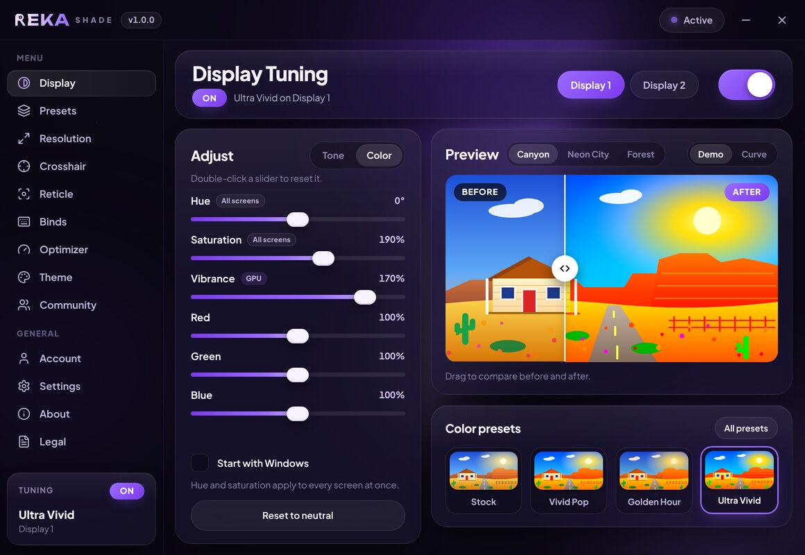
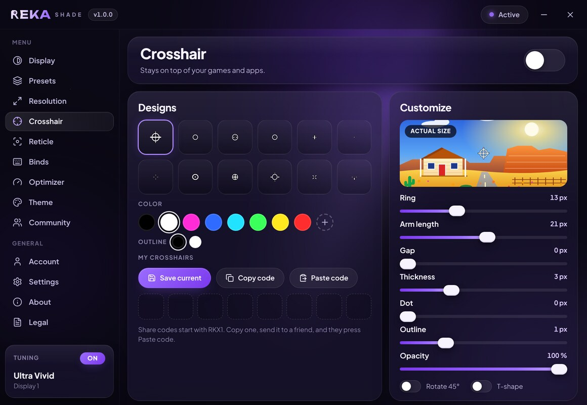
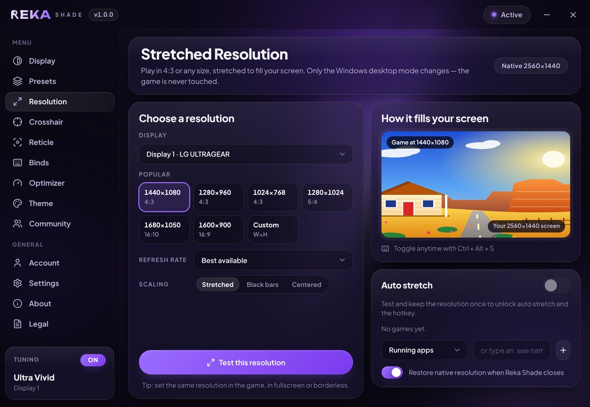

<p align="center"></p>

<p align="center"><b>Display tuning · crosshair overlay · stretched resolution · Windows optimizer</b><br>
Built to never touch your games — so it works with every game, anti-cheat included.</p>

<p align="center"><a href="#-en-français">🇫🇷 Version française plus bas</a></p>

---



## Features

| | |
|---|---|
| **Display tuning** | Hue, saturation, vibrance, red/green/blue, brightness, contrast, gamma and colour temperature, per display. Live before/after preview that uses the exact same maths as the engine, plus tone-curve view. |
| **Presets** | 11 built-in looks (Ultra Vivid, Night Vision, Competitive Clarity…), your own presets, share codes (`RKP1-…`), and **game profiles** that switch preset automatically while a game is in focus. |
| **Stretched resolution** | 1440×1080, 1280×960, 1280×1024, custom… with stretched / black-bars / centred scaling, a 15-second “keep or revert” safety net, a hotkey, and **auto stretch** while chosen games run. |
| **Crosshair** | 12 designs, colours, ring/arm/gap/thickness/dot/outline/opacity, rotate 45°, T-shape, 8 save slots, share codes (`RKX1-…`). Pixel-exact “actual size” preview. |
| **Reticle** | Image reticles (holo, chevron, mil-dot…) or your own PNG/SVG, plus placement: screen, fine offset, follow the active window, only over fullscreen apps, hide from screenshots/streams, hide while holding a key (e.g. right click to aim). |
| **Binds** | Global hotkeys (toggle tuning, crosshair, stretch, next/previous preset, open app, panic). Keys are read, never blocked. |
| **Optimizer** | 10 reversible Windows tweaks (power plan, Game Mode, Game Bar recording, windowed game boost, mouse acceleration, Sticky Keys popup, notifications, background apps, transparency, animations) + temp clean-up. “Undo all” restores the exact previous values. |
| **App** | English / Français, 7 accent colours and 4 backgrounds, tray icon, start with Windows, settings export/import, **automatic updates**. |

| Crosshair | Stretched resolution |
|---|---|
|  |  |

## Why it's anti-cheat friendly

Reka Shade never opens, reads, writes, hooks or injects into a game process. Everything goes through
Windows and the GPU driver, the same way their own control panels do:

| Feature | How it works |
|---|---|
| Tone, gamma, RGB | The display's hardware gamma table (`SetDeviceGammaRamp`). Your existing calibration curve is preserved underneath. |
| Vibrance | NVIDIA digital vibrance (NVAPI) or AMD saturation (ADL) — the same switch as NVIDIA Control Panel / AMD Software. Zero latency, works in exclusive fullscreen. Other GPUs fall back to the Windows colour engine. |
| Hue, saturation | Windows' built-in full-screen colour engine (`MagSetFullscreenColorEffect`, the one behind Accessibility › Colour filters). |
| Crosshair / reticle | An ordinary layered, click-through, top-most window — like the Discord or Xbox Game Bar overlays. |
| Stretched resolution | A normal Windows display-mode change (`ChangeDisplaySettingsEx` + `SetDisplayConfig` scaling), never written to the registry, so a reboot always restores your native mode. |
| Game detection | The process list Task Manager shows (`CreateToolhelp32Snapshot`) and the foreground window's metadata. No process handle is opened. |
| Hotkeys | Polling the key state (`GetAsyncKeyState`). No keyboard hook, no simulated input. |

**Good to know:** exclusive-fullscreen games draw over every overlay and over Windows' colour engine — use
borderless/windowed mode for the crosshair, hue and saturation. Tone and GPU vibrance work in every mode.
Some competitive platforms and tournaments don't allow crosshair overlays: check the rules of what you play.

## Install

Download from **[Releases](https://github.com/1337133713377/rekashade/releases/latest)**:

- `RekaShade-Setup-x.y.z.exe` — installer (per user, no admin rights, Start menu + desktop shortcuts, uninstaller), or
- `RekaShade.exe` — portable single file.

Requires Windows 10/11 (64-bit) and the Microsoft Edge WebView2 runtime (already on Windows 11; the installer adds it if missing).
The executables are not code-signed yet, so SmartScreen may show “Windows protected your PC” the first time → *More info* › *Run anyway*.

### Automatic updates

On start (and from *About*), Reka Shade asks GitHub for the latest release, downloads `RekaShade.exe` from
GitHub only, checks it against the release's `SHA256SUMS.txt`, swaps it in place and restarts. Your settings
live in `%APPDATA%\RekaShade` and are kept.

## Build from source

Requirements: Go 1.26+, Node 22+, [Wails CLI](https://wails.io) v2.17.1, and NSIS (`makensis`) for the installer.
It cross-compiles from Linux or builds on Windows:

```bash
go install github.com/wailsapp/wails/v2/cmd/wails@v2.17.1
```

```bash
wails build -platform windows/amd64 -nsis -installscope user -webview2 embed -skipbindings -trimpath -ldflags "-s -w -X main.version=1.0.0"
```

Output: `build/bin/RekaShade.exe` and `build/bin/RekaShade-amd64-installer.exe`.

UI only, in a browser with a simulated backend (handy for design work):

```bash
cd frontend && npm install && npm run dev
```

Tests:

```bash
go test ./internal/colorx/... ./internal/config/... ./internal/updater/...
```

## Publishing a release (feeds the auto-updater)

1. Bump `info.productVersion` in `wails.json`.
2. Tag and push:

```bash
git tag v1.0.1
```

```bash
git push origin v1.0.1
```

GitHub Actions (`.github/workflows/build.yml`) builds the exe and installer, writes `SHA256SUMS.txt` and
publishes the release. Every installed copy picks it up on its next update check. Tags with a suffix
(`v1.1.0-beta.1`) are published as pre-releases and are not offered to users.

## Project layout

```
main.go, app*.go        Wails app: lifecycle, bindings used by the UI, tray, hotkeys, game detection
internal/win            Raw Win32 bindings (struct layouts checked at compile time)
internal/display        Monitors, gamma engine, Windows colour matrix, NVIDIA/AMD vibrance, resolution & scaling
internal/host           Native UI thread: crosshair overlay window, tray icon, system broadcasts
internal/colorx         Colour maths (mirrored 1:1 in frontend/src/lib/color.ts)
internal/optimizer      Reversible Windows tweaks
internal/updater        GitHub Releases updater with SHA-256 verification
internal/config         Settings file, defaults (defaults.json is shared with the UI)
frontend/               Vue 3 + Reka UI interface
build/                  Icons, Windows manifest/version info, NSIS installer script
assets/brand            Logo sources (SVG)
```

---

## 🇫🇷 En français

**Reka Shade** règle les couleurs de vos écrans (teinte, saturation, vibrance, RVB, luminosité, contraste,
gamma, température), affiche un **viseur** ou un **réticule** par-dessus vos jeux, passe en **résolution étirée**
(1440×1080…) et applique des **optimisations Windows** réversibles — **sans jamais toucher au jeu**. Rien n'est
injecté, aucune mémoire n'est lue : tout passe par Windows et le pilote GPU, comme leurs propres panneaux de
réglage. C'est pour ça que ça marche sur tous les jeux, même avec un anti-triche.

- **Installer :** téléchargez `RekaShade-Setup-x.y.z.exe` dans les [Releases](https://github.com/1337133713377/rekashade/releases/latest) (installation par utilisateur, sans droits admin) ou la version portable `RekaShade.exe`.
- **Mises à jour automatiques :** au démarrage, Reka Shade vérifie la dernière version sur GitHub, la télécharge, vérifie son empreinte SHA-256, la remplace et redémarre. Vos réglages (`%APPDATA%\RekaShade`) sont conservés.
- **Langue :** l'interface est en français si Windows l'est (modifiable dans *Paramètres*).
- **Bon à savoir :** en plein écran exclusif, le jeu passe par-dessus toute superposition et le moteur couleur de Windows — utilisez le mode fenêtré sans bordure pour le viseur, la teinte et la saturation. Les tons et la vibrance GPU marchent dans tous les modes. Certaines plateformes compétitives interdisent les viseurs en superposition : vérifiez les règles.
- **Publier une version :** changez `info.productVersion` dans `wails.json`, puis poussez un tag `vX.Y.Z` — GitHub Actions construit l'exe et l'installateur et publie la release que les copies installées récupèrent automatiquement.
